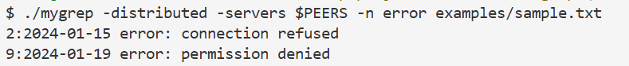
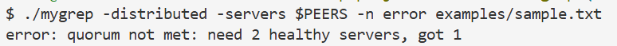

# mygrep

Распределенный grep на Go. Как и команда grep, выводит строки файла или stdin, подходящие под шаблон. По умолчанию шаблон — регулярное выражение, с флагом `-F` ищется точный текст. В многосерверном режиме файл режется на фрагменты, узлы обрабатывают их параллельно. Поиск начинается, если живы больше половины узлов (`N/2+1`). Ответ возвращается, когда обработана каждая часть файла.

## Требования

- [Go](https://go.dev/dl/) 1.25+
- системный `grep` в PATH (для сравнительных тестов)

## Запуск

1. Клонировать репозиторий:

```bash
git clone https://github.com/sonni-a/distributed-grep.git
cd distributed-grep
```

1. Собрать бинарник:

```bash
go build -o mygrep ./cmd/mygrep
```


## Локальный режим

```bash
./mygrep error examples/sample.txt # ищем слово error в файле, выводятся строки с error
./mygrep -n -i warn examples/sample.txt # ищем warn, не учитывая регистр и с номерами строк
cat examples/sample.txt | ./mygrep -F "error:"  # stdin: ищем текст error: (не регулярное выражение)
```


| Флаг | Значение                              |
| ---- | ------------------------------------- |
| `-i` | без регистра                          |
| `-v` | строки, где шаблона нет               |
| `-n` | номера строк                          |
| `-F` | точный текст, не регулярное выражение |


## Кластер

Откройте три терминала и в каждом оставьте работать свой сервер. Поиск запускайте в четвёртом. Если выключить 1 узел до запуска, поиск продолжится. Если выключить 2, живых узлов не хватит и поиск остановится.

```bash
PEERS=localhost:8081,localhost:8082,localhost:8083

# терминал 1
./mygrep server -addr :8081 -id node-1 -advertise localhost:8081 -peers $PEERS
# терминал 2
./mygrep server -addr :8082 -id node-2 -advertise localhost:8082 -peers $PEERS
# терминал 3
./mygrep server -addr :8083 -id node-3 -advertise localhost:8083 -peers $PEERS

# терминал 4
./mygrep -distributed -servers $PEERS -n error examples/sample.txt
```

Поиск при 2 живых узлах из 3 (кворум выполняется): 

Поиск при 1 живом узле из 3 останавливается (кворум не выполняется):


## Тесты

```bash
go test ./...
```


## Структура

```
distributed-grep/
├── cmd/mygrep/          # CLI: флаги, server / поиск
├── internal/
│   ├── grep/            # поиск по строкам
│   ├── protocol/        # JSON, шарды, кворум N/2+1
│   ├── client/          # локальный и distributed-клиент
│   └── server/          # HTTP-узел, координация
├── tests/               # сравнение с grep, интеграция кластера
├── examples/sample.txt
└── README.md
```

